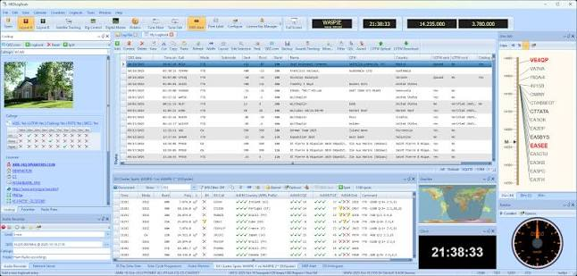
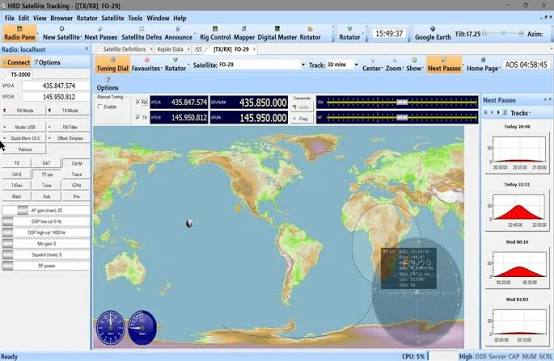
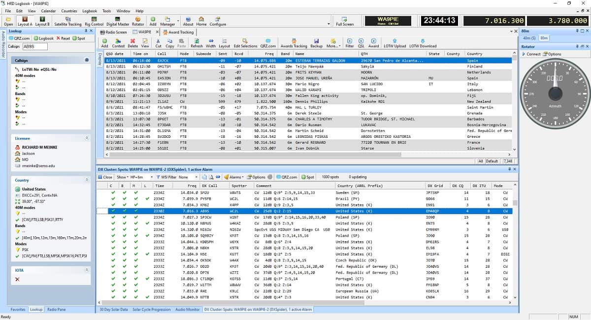

# Ham Radio Deluxe Coordinated Control and QSO Logging

Ham Radio Deluxe brings radio control, contact logging, digital modes, antenna positioning, and satellite tracking into one Windows station workflow.
Use the suite to keep operating information consistent as it moves from the transceiver to the contact record.

[](https://ham-radio-deluxe.github.io/ham-radio-deluxe/)

## Assign a clear role to each station component

The ham radio deluxe software suite contains five cooperating applications.
Decide which application owns each connection before opening a complete operating session.

| Station responsibility | HRD application | Information involved |
| --- | --- | --- |
| Transceiver communication | Rig Control | Frequency, mode, VFO state |
| Contact record | Logbook | Callsign, time, band, mode, reports |
| Supported sound-card digital modes | DM-780 | Receive audio, decoded text, transmit audio |
| Antenna direction | Rotor Control | Controller connection and pointing information |
| Orbital pass coordination | Satellite Tracking | Pass timing, pointing, Doppler corrections |

Keep radio-control settings separate from audio-device settings.
A working CAT connection establishes communication with the radio; inspect the selected sound devices separately for digital operation.

The [HRD feature overview](https://www.hamradiodeluxe.com/features/) describes the five applications and their integration.
Build the station around the equipment actually connected, rather than assuming every supported function is available on every radio.

### Inspect receive state before relying on it

For ham radio deluxe rig control, compare the displayed frequency and mode with the radio's front panel.
Record the selected radio model, interface, port, and communication settings.

Identify which application directly owns the radio's control port.
When another application needs rig information, configure the intended sharing route instead of opening the same physical connection independently.

The following reads frequency, mode, and VFO state from a demonstration backend.
Model 1 is the dummy radio; these commands do not connect to station hardware.

```bash
rigctl -m 1 f
rigctl -m 1 m
rigctl -m 1 v
```

The commands illustrate three distinct queries.
For an actual HRD connection, use the selected radio's supported controls and verify the resulting display.

The interface wrapper [rigclass.cc](c++/rigclass.cc) illustrates the separation between an application and radio-control calls.
The historical Pascal interface [hamlib_rigapi.pas](extra/kylix/hamlib_rigapi.pas) exposes another language binding to similar equipment-control concepts.



### Keep VFO identity attached to the frequency

A frequency value needs context when a radio has multiple VFOs or split operation.
Record which VFO supplies receive information and which setting determines the transmit frequency.

[VFOs.txt](VFOs.txt) documents one library's VFO abstraction and its dated assumptions.
Compare that distinction with the actual radio behavior when reviewing split or satellite operation.

HRD's [Rig Control description](https://www.hamradiodeluxe.com/features/rigcontrol/) explains its role as the communication hub for the suite.
Check the exact supported radio model when planning a station connection.

## Make the contact record the durable result

Use ham radio deluxe logbook to retain what was actually worked.
Automatic frequency and mode transfer reduces repeated entry, while the operator still verifies the contact details.

For each completed QSO, inspect:

- The contacted callsign.
- UTC date and time.
- Band and operating mode.
- Sent and received reports.
- Station location or activity reference, when applicable.
- Any notes needed to interpret the contact later.

A successful callbook lookup is background information about a station.
The contact record should describe the exchange that actually occurred.

HRD documents its logging and service integrations on the [Logbook feature page](https://www.hamradiodeluxe.com/features/logbook/).
Confirm a saved record locally before treating a later service upload as complete.

### Inspect an ADIF exchange before a large transfer

Use a small export to check how contact fields are represented.
The example below creates a demonstration record with an illustrative callsign, date, time, band, and mode.

```python
fields = {
    "CALL": "N0CALL", "QSO_DATE": "20261105",
    "TIME_ON": "120000", "BAND": "20m", "MODE": "SSB",
}
record = "".join(f"<{name}:{len(value)}>{value}" for name, value in fields.items())
print(record + "<EOR>")
```

ADIF fields carry their data length, and the end-of-record marker closes a contact.
The [ADIF specification](https://www.adif.org/adif302.htm) describes this interchange structure.

When transferring real records, compare a representative export with the corresponding logbook rows.
Check timestamps, mode mapping, band information, and any application-specific fields needed by the destination.

The [HRD export instructions](https://support.hamradiodeluxe.com/support/solutions/articles/51000052695-exporting-log-files) describe exporting the selected log data.
Keep the exported file with the selection criteria used to produce it.

### Preserve a native backup as well as an interchange copy

ADIF exchanges common contact fields between applications.
HRD's [backup documentation](https://support.hamradiodeluxe.com/support/solutions/articles/51000052696-backup-restore-logbook-data) distinguishes that purpose from preserving its own logbook information.

Keep both the recovery copy and the interchange copy identifiable.
Record the database or log selection, export date, and contact count so the files can be interpreted later.

## Route digital audio to the intended application

The ham radio deluxe digital master 780 component supports modes including PSK31, RTTY, and CW.
Select the intended mode and check the receive-audio path before interpreting the waterfall or decoded text.

For a reproducible audio configuration, record:

- The radio or interface used for audio.
- Windows input and output device names.
- The audio devices selected in DM-780.
- The chosen mode and relevant operating settings.
- How the application obtains frequency and mode information.

A waterfall indicates incoming audio activity.
Review the selected mode, signal conditions, and audio path when deciding why text is or is not being decoded.



The [DM-780 feature page](https://www.hamradiodeluxe.com/features/dm780/) describes its supported digital-mode workflows.
Keep received text, operator edits, and the final contact entry distinguishable during logging.

### Treat FT8 as an integration workflow

HRD documents FT8 and FT4 operation through applications such as WSJT-X and JTDX.
Those applications perform the mode-specific work while their completed QSOs can populate HRD Logbook.

Confirm the intended logging route with one completed contact.
Check that its callsign, time, band, and mode arrive once in the correct log.

Avoid using a DM-780 mode selection as evidence that the separate FT8 integration is configured.
Retain the integration settings with the station record.

## Coordinate a satellite pass across two moving systems

Satellite operation combines changing radio frequencies with changing antenna direction.
Confirm the observer location, computer clock, selected satellite, and orbital-element data used to predict the pass.

HRD's [Satellite Tracking module](https://www.hamradiodeluxe.com/features/sattrack/) supplies pass predictions and coordinates Doppler tuning and antenna pointing through the other applications.
Keep the pass identity and timing visible while reviewing that coordination.

### Distinguish the predicted direction from controller feedback

A predicted azimuth and elevation are target coordinates.
Compare the rotor application's controller information with the antenna system's actual configuration.

The rotor wrapper [rotclass.cc](c++/rotclass.cc) and Pascal declarations in [hamlib_rotapi.pas](extra/kylix/hamlib_rotapi.pas) illustrate a separate control interface for this equipment.
The amplifier wrapper [ampclass.cc](c++/ampclass.cc) likewise represents a different device category, rather than a transceiver VFO.

Use HRD's [Rotor Control documentation](https://www.hamradiodeluxe.com/features/rotor/) to check the supported controller workflow.
Record the controller model, coordinate convention, and configured travel limits.



Before relying on an automated pass, compare the predicted direction, rotor display, and radio tuning behavior over the same interval.
A correct pass prediction and a correct hardware connection are separate observations.

## Keep an operating profile that survives the next session

Retain the radio model, control interface, audio-device names, station identity, and logbook selection together.
Include the installed HRD build and the versions of applications participating in digital-mode logging.

After changing one part of the station, repeat the observation that depends on it.
For example, a changed USB connection calls for checking port identity; a changed audio interface calls for checking DM-780 device selection.

Keep a short session note when troubleshooting:

- What the operator expected.
- What each relevant application displayed.
- Which device or integration setting changed.
- Whether the issue affected control, decoding, logging, or pointing.

That distinction helps locate a problem without treating every station symptom as a failure of the same module.

## Example and source scope

The rigctl commands use Hamlib's dummy backend, as described in its [command reference](https://hamlib.sourceforge.net/html/rigctl.1.html).
The ADIF generator is an independent Python example.
All six linked local files belong to the supplied partial Hamlib snapshot; they illustrate control interfaces and do not describe HRD's internal implementation or prove HRD equipment compatibility.

## Related Search Terms

ham radio deluxe, ham radio deluxe software, ham radio deluxe rig control, ham radio deluxe logbook, ham radio deluxe digital master 780, amateur-radio, hamradio, rig-control, logbook, qso, adif, digital-modes, satellite-tracking, rotor-control, windows
